# Keeproll — UI/UX Review, build 5 candidate

**Build:** 1.0 (4) plus the build 5 fixes, commit `2f30c58` · **Date:** 20 Oct 2026
**Devices:** iPhone 17 Pro and iPhone 16e simulators (iOS 26), light and dark mode, default and largest text size.
**Screenshots:** [`docs/ux-review/`](ux-review/), 28 captures. Each finding names the screenshot it comes from.

---

## Verdict

**The app is in good shape.** Keeproll already gets the hard parts right:

- The whole app looks like one product.
- The copy is honest, nothing is pre-selected, and the iOS delete prompt is never hidden.
- Review is a clear last step before anything is removed.

**What holds it back is consistency, not missing features:**

- The same tick means "keep" on some screens and "remove" on others.
- Two one-tap bulk actions have no label.
- Some categories have two different names.
- A few numbers don't match between screens.

Each of these is small to fix, and together they matter more than any new feature.

| Priority | Count | What it means |
|---|---|---|
| **P1** | 4 | Fix before build 5. Each one can lead someone to remove the wrong thing, or to misread what will happen. |
| **P2** | 7 | Fix before the App Store update. Confusing, but nothing is lost. |
| **P3** | 9 | Polish. |

---

## P1: fix before build 5

### P1-1. A tick means "keep" on one screen and "remove" on another

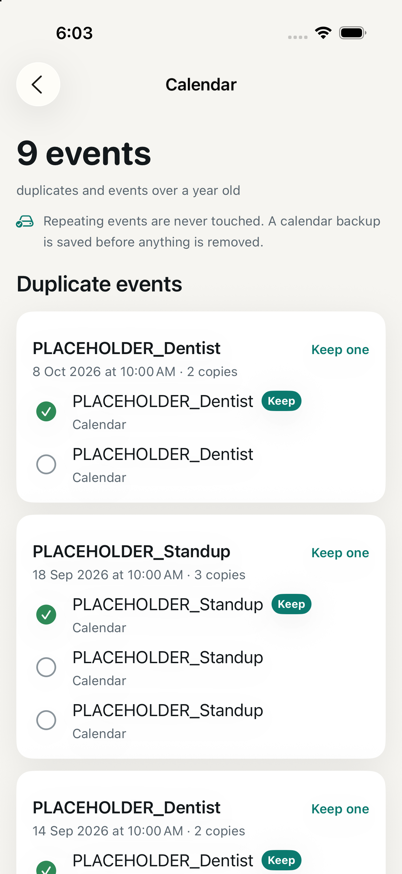 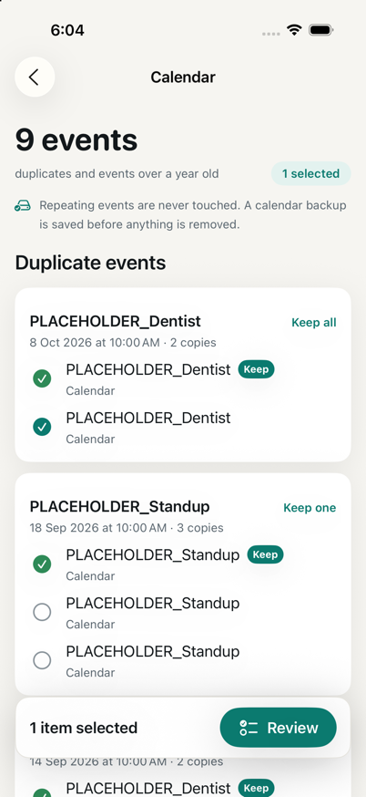 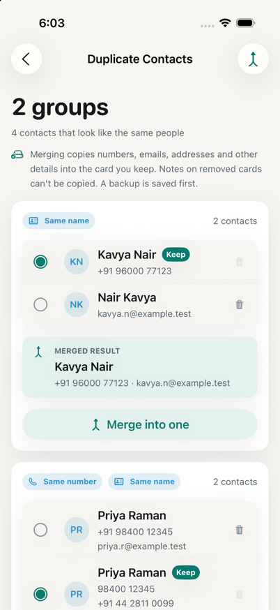

- **What happens:**
  - In Similar, Screenshots, Videos and every photo grid, a filled tick means **remove this**.
  - In **Calendar**, the green filled tick next to the kept event means **keep this**. When you then tick a duplicate to remove it, it gets a near-identical teal tick. In the second screenshot, two rows in the same card show the same mark with opposite meanings.
  - In **Contacts**, a filled radio button means **keep this card**, and each row also has a separate trash icon.
- **Why it matters:** this is a deletion app. Deletion only happens on Review, but anyone who learned "tick = remove" in Photos will misread Calendar and Contacts.
- **Change:** use one rule everywhere: **a tick always means "will be removed"**.
  - **Calendar:** the kept event shows only the `Keep` badge, with no tick. Duplicates show empty circles that fill when you select them for removal, exactly like the photo grids.
  - **Contacts:**
    - Keep the radio for "which card to keep", since merging really is a choice of one.
    - Restyle it as a star or "Keep" pill, like Similar's **Best** badge, so it doesn't look like a selection tick.
    - Drop the per-row trash icon. Merge already removes the extra cards.
- **Where:** `Features/Calendar/`, `Features/Contacts/DuplicateContactsView.swift`.

### P1-2. Two icon-only buttons select many items at once

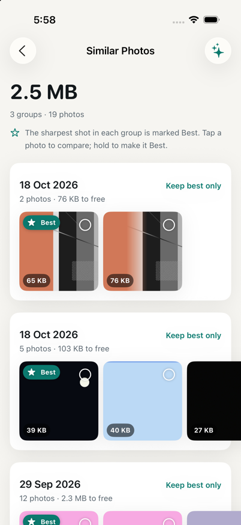 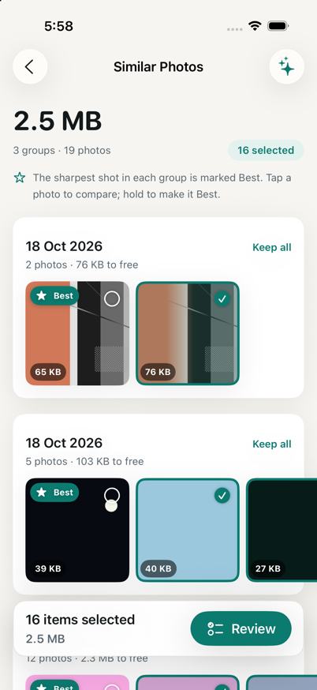

- **What happens:**
  - In Similar Photos, the ✦ button at the top right silently selects **16 photos** in one tap.
  - In Duplicate Contacts, the merge icon merges every group.
  - Neither shows any text, while every other screen uses a word ("Select all", "Select very likely").
- **Change:** show the text, consistent with the rest of the app:
  - The buttons already have titles in code: "Smart select" / "Clear" (`SimilarPhotosView.swift:34`) and "Merge all" (`DuplicateContactsView.swift:43`). Only the icon is drawn.
  - Use `.labelStyle(.titleOnly)`.
  - Rename "Smart select" to **"Keep best in all"**, which says what it does.

### P1-3. The final destructive button says "Confirm", not what happens

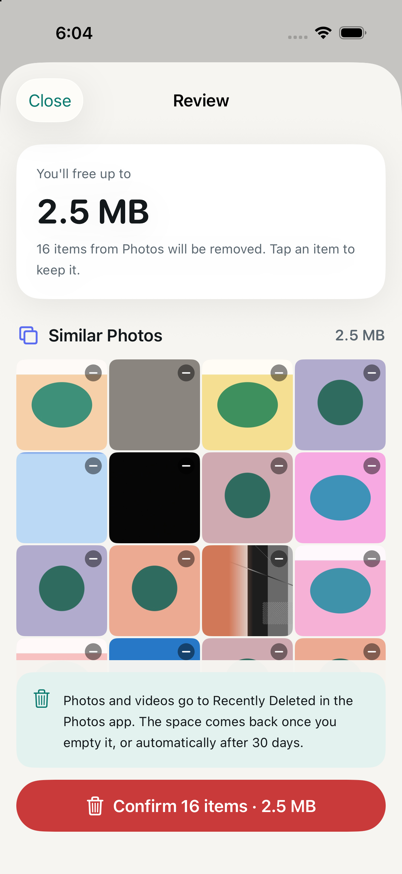

- **What happens:** the red Review button reads **"Confirm 16 items · 2.5 MB"**.
- **Why it matters:** CLAUDE.md §4 says: *always name the consequence ("Delete 42 items · 3.1 GB")*. "Confirm" is the one place that rule matters most.
- **Change:**
  - **"Delete 16 items · 2.5 MB"**.
  - When the plan mixes actions, use "Remove 16 items · Merge 2 contacts", or similar.
  - The banner above already explains Recently Deleted, so "Delete" is honest.

### P1-4. The Home ring doesn't show how full the phone is, and overstates what can be freed

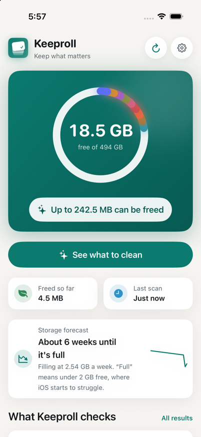 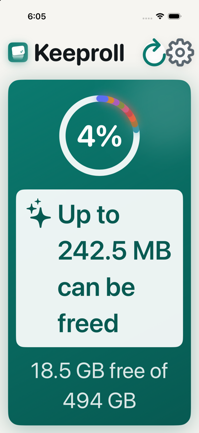

- **What happens:**
  - Used space is solid white on a translucent white track, so a 96%-full phone looks like a closed white circle.
  - The coloured category arcs have a **minimum visible size** (`StorageRing.arcs`), so 242 MB of a 494 GB phone looks like a tenth of the disk. That's about 200 times too large.
  - At the largest text size, the centre shows **"4%"** with no word saying it means free space.
- **Change:**
  - Put the meaning in words in the centre: **"18.5 GB free"** over **"96% used"**.
  - At large text sizes, show "4% free".
  - Remove the fake-size category arcs from the ring. Show what can be freed only in the pill below, which already does it well.
  - Or keep a small coloured "cleanable" marker that doesn't claim to be to scale.
- **Where:** `Core/DesignSystem/Components/StorageRing.swift`.

---

## P2: before the App Store update

### P2-1. Home and Results both list the same 12 categories, under different names

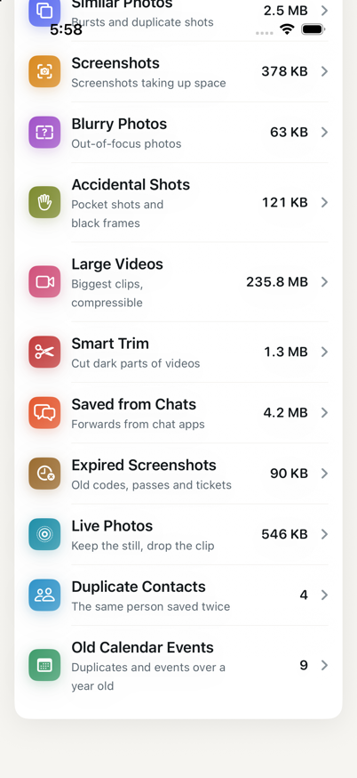 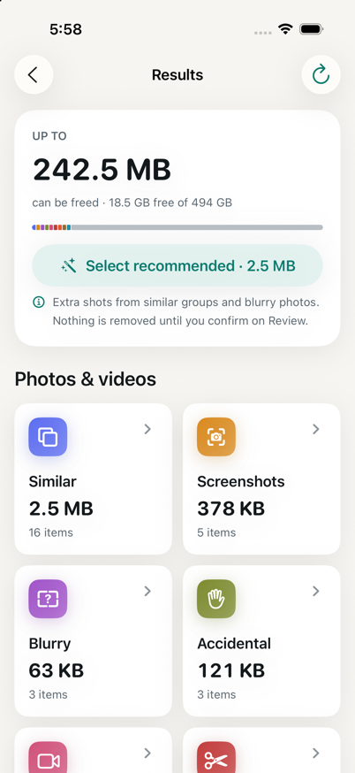 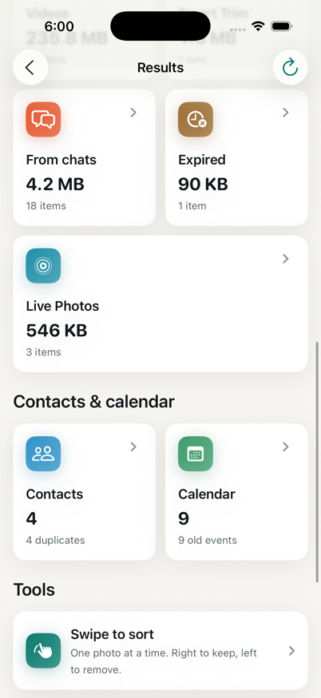

- **Two overviews:** Home has a 12-row "What Keeproll checks" list, and Results has a 12-tile grid. Both lead to the same screens.
- **Names drift between them:**

| Home | Results | Screen title |
|---|---|---|
| Large Videos | Videos | Large Videos |
| Saved from Chats | From chats | Saved from Chats |
| Expired Screenshots | Expired | Expired Screenshots |
| Duplicate Contacts | Contacts | Duplicate Contacts |
| Old Calendar Events | Calendar | Calendar |

- **Recommended change:**
  - **Home** shows the **top 3 categories by size**, then "See all 12".
  - **Results** stays the full grid, and is the only full list.
  - Use **one name per category** everywhere: the full name, shortened only by the system when there's no room.
  - Rename the Calendar screen title to "Old Calendar Events".

### P2-2. The Home list isn't sorted, and mixes sizes with counts

- **What happens:**
  - The biggest category (Large Videos, 235.8 MB) is sixth, below Blurry (63 KB).
  - Contacts and Calendar show a bare "4" and "9", next to rows that show megabytes.
- **Change:**
  - Sort by size, largest first, with Contacts and Calendar after the photo categories.
  - Label the counts: "4 contacts", "9 events".

### P2-3. Numbers that don't agree between screens

| Where | Shows | Problem | Change |
|---|---|---|---|
| Results → Contacts tile | "4 · 4 duplicates" | Only 2 cards would be removed: the count includes the cards you keep (`CategoryCard.swift:113`, `duplicateContactCount`) | "2 duplicates", counting the extra cards only |
| Live Photos grid ([17](ux-review/17-live.png), [18](ux-review/18-live-selected.png)) | Badge "446 KB", button "save 223 KB" | The badge is the whole photo, but only the clip is freed | Show the clip size on the badge, or "saves 223 KB" |
| Results → Similar | "16 items" | The screen says "3 groups · 19 photos" | "16 extra shots" on the tile, and "19 photos · 16 extra" on the screen |
| Settings → Calendar backup ([25](ux-review/25-settings-2.png)) | "32 bytes" | Looks empty and worrying | "No events" when it's empty, or say what the backup holds ("9 events") |

### P2-4. The Vault asks for a passcode before you can read what it is

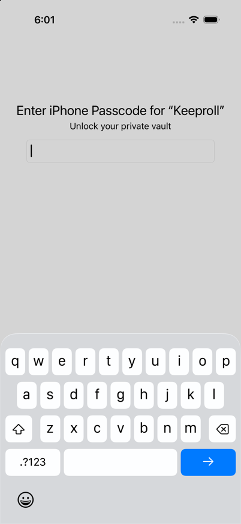 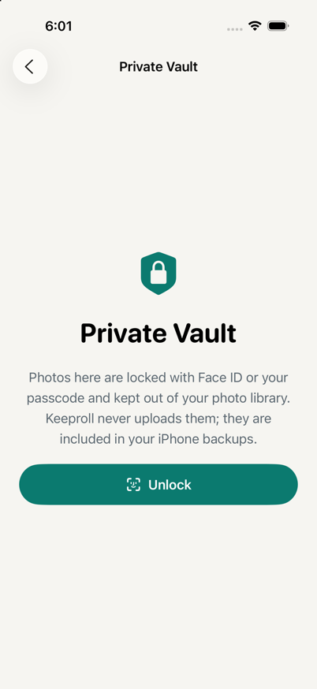

- **What happens:** tapping "Private vault" shows the system passcode or Face ID prompt immediately, over the explainer screen. A first-time user is asked to authenticate for something they haven't seen yet.
- **Change:**
  - On the first visit, show the explainer and wait for **Unlock**.
  - Auto-prompt only on later visits, or after the user has added something to the vault.

### P2-5. Red appears outside Review

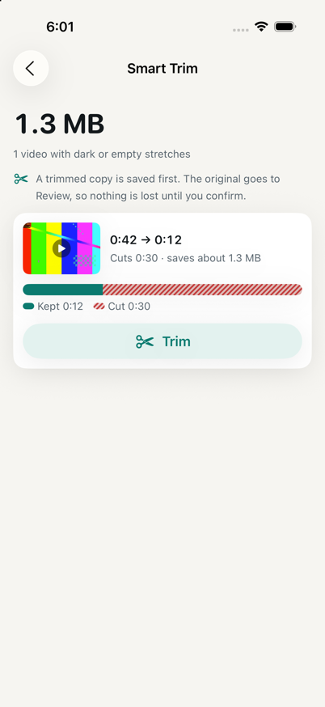 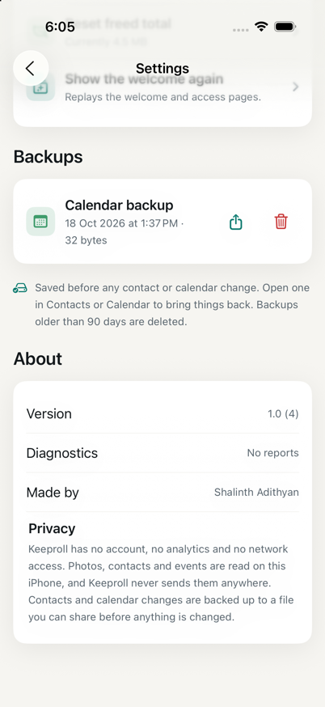

- **What happens:**
  - Smart Trim draws the cut part as **red stripes**.
  - Settings shows a **red trash icon** on the backup row.
  - CLAUDE.md §4 says red is reserved for the final Review button. Every extra red use weakens that signal.
- **Change:**
  - Show the cut part in neutral hatched grey (`inkTertiary`), keeping teal for "kept".
  - Use a secondary-coloured trash in Settings. Red can stay inside the confirmation dialog.

### P2-6. The selected state on photos hides the photo

- **What happens:** a selected thumbnail gets a dark teal overlay, so in Similar the photo underneath is hard to see. That's exactly the screen where you compare shots.
- **Change:**
  - Keep the teal border and tick.
  - Lower the overlay to a light dim (about 25%), or remove it.
  - The tick and border already carry the meaning.

### P2-7. Tools are hard to find

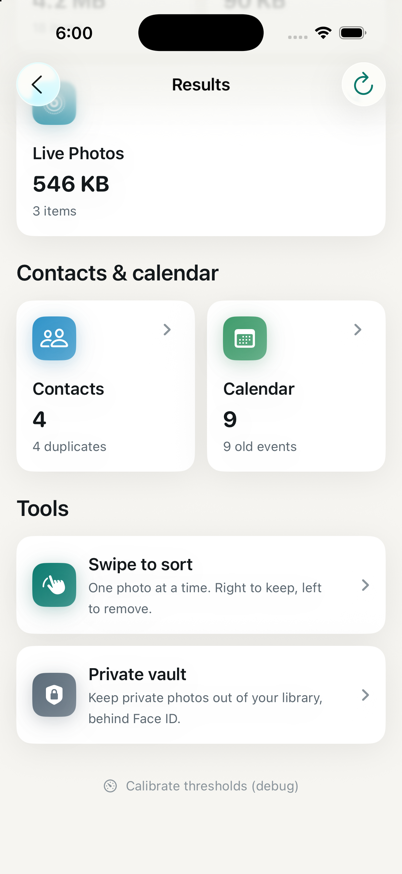

- **What happens:** Swipe to sort and Private vault exist only at the very bottom of Results. Home doesn't mention them.
- **Change:** add one Home row, "Tools · Swipe to sort, Private vault", under the categories. Or add a "Sort one by one" entry point on photo-heavy screens.

---

## P3: polish

| # | Finding | Screenshot | Change |
|---|---|---|---|
| 1 | "Last scan **8 Minutes Ago**": Title Case, because of `.localizedCapitalized` (`HomeViewModel.swift:38`) | [26](ux-review/26-home-dark.png) | Capitalise only the first letter: "8 minutes ago" |
| 2 | "1 screenshot past **their** date" | [16](ux-review/16-expired.png) | Inflect: "past its date" / "past their date" |
| 3 | The hint and "Clear scan cache" use the `externaldrive` symbol, which looks like a car at 16 pt | [19](ux-review/19-contacts.png), [24](ux-review/24-settings.png) | `arrow.counterclockwise.circle` for backups, `internaldrive` for the cache |
| 4 | Swipe to sort uses a **heart** for Keep, which reads as "add to Favourites" in Photos | [10](ux-review/10-swipe.png) | `checkmark` for Keep, or make Keep really favourite the photo |
| 5 | White screenshots on a cream background have no edge, so their thumbnails disappear | [06](ux-review/06-screenshots.png), [16](ux-review/16-expired.png) | A 0.5 pt `separator` stroke on thumbnails |
| 6 | Home's forecast chart is a flat line with a hook, and squeezes the text | [01](ux-review/01-home.png) | Give the chart its own row under the text, or show a small "−2.5 GB / week" figure instead |
| 7 | The hero pill "Up to 242.5 MB can be freed" (and "Photo access needed") looks like a button but does nothing; the real button is below | [01](ux-review/01-home.png), [28](ux-review/28-16e-home.png) | Make the pill plain text, or make it the button |
| 8 | In dark mode the hero is a large bright mint panel, the brightest thing on the screen | [26](ux-review/26-home-dark.png) | Use the deep teal gradient in dark mode too; keep mint for the button |
| 9 | "90% sure" on Expired screenshots is jargon | [16](ux-review/16-expired.png) | "Very likely" / "Likely", as Saved from Chats already does |

---

## What already works well (keep it)

- **Review as the single gate:**
  - It has a clear "You'll free up to" header and explains Recently Deleted in plain words.
  - Tapping an item keeps it ([23](ux-review/23-review.png)).
- **Every category screen has the same anatomy:** large number, one-line summary, one hint row, then content. Once you learn one screen you know them all.
- **Similar Photos' Best badge** with "Keep best only" per group is the right model. Apply the same idea to Calendar and Contacts (P1-1).
- **Smart Trim's timeline:** you can see before tapping what will be cut ([14](ux-review/14-trim.png)).
- **Large Videos:**
  - Size filters, durations on thumbnails, and "Save ~51.5 MB" on the video that can be compressed ([13](ux-review/13-videos.png)).
- **Copy:**
  - Never "junk" or "boost".
  - Favourites are never suggested, and the screens say so.
  - Settings' privacy paragraph is plain and true ([25](ux-review/25-settings-2.png)).
- **Dark mode and the 6.1-inch 16e:** no clipping, no contrast failures ([26](ux-review/26-home-dark.png), [28](ux-review/28-16e-home.png)).

---

## Suggested order

1. **P1-1 to P1-3.** Copy and styling only, about half a day, with no logic changes except dropping the Contacts trash icon.
2. **P1-4,** the ring. A small change to one component, but test it at every text size.
3. **P2-1 and P2-2** together: one name per category, and Home shows the top 3 sorted by size.
4. **P2-3 to P2-7.**
5. **P3** whenever you're in those files.

## Not covered

- **Onboarding, the Summary screen and the iOS delete prompt:** walked in the earlier QA passes, and unchanged since.
- **VoiceOver:** not walked this pass.
- **Hindi and Tamil layouts:** check the longer translations against the P2-1 renames.
- **Real device:** haptics, scroll performance on a large library.
